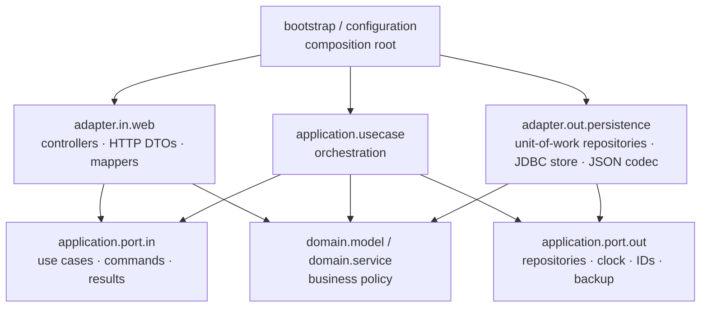
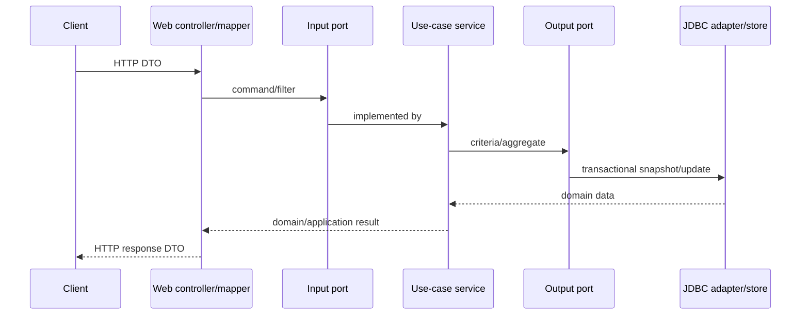

# Backend architecture contributor guide

## Dependency rule and packages

The backend uses Clean Architecture with DDD tactical patterns. Dependencies point inward: **adapters → application → domain**. The domain owns policy, the application owns use cases and ports, adapters translate technologies, and `configuration` is the composition root.

| Package                                                              | Allowed dependencies                                                                                                                                                                 |
| -------------------------------------------------------------------- | ------------------------------------------------------------------------------------------------------------------------------------------------------------------------------------ |
| `domain.model`, `domain.service`                                     | JDK and `domain` only; never application, adapters, configuration, Spring, Jakarta, or Jackson                                                                                       |
| `application.port.*`, `application.usecase`, `application.exception` | JDK, domain, and application; never adapters, configuration, Spring/Jakarta, or Jackson                                                                                              |
| `adapter.in.web`                                                     | input ports/commands/results, domain, its own DTOs/mappers, Spring/Jakarta web APIs; never use-case implementations, outbound adapters, or configuration                             |
| `adapter.out.persistence[.json/.jdbc]`                                     | output ports, domain, application persistence/import exceptions, its records/mappers and JDBC/H2/Liquibase/Jackson/filesystem APIs; never input ports, web, use-case implementations, or configuration |
| `configuration` and bootstrap                                        | any layer only to wire objects/framework behavior; no business policy                                                                                                                |

Architecture tests encode these boundaries, including a prohibition on JDBC/vendor dependencies in inner layers. Configuration restrictions target the application composition-root package, not third-party packages that happen to be named `configuration`. Introduce an inward-owned abstraction instead of granting an inner layer an exception.

## Domain model and invariants

`InvestmentEntry` and `InvestmentOperation` are immutable aggregate roots. Each repository changes one aggregate at a time. There are no independently mutable child entities. `PortfolioHistory` groups selected data for calculation and `PortfolioPerformance` is a domain result, not a stored aggregate.

Value objects include both ID types, `OwnerId`, `Money`, `AssetCategory`, `AssetKey`, `ValuationDate`, `ValuationSnapshot`, and `CashFlow`; enums are domain vocabulary. `PortfolioPerformanceCalculator` and `RateOfReturnCalculator`/`NumericalRateOfReturnCalculator` are pure domain services.

Constructors/factories and reconstitution must enforce the same invariants: required IDs/category/owner/dates/timestamps; lowercase stable owner IDs; type/subcategory compatibility in `AssetCategory`; two-decimal half-up PLN normalization and sign rules in `Money`; update time not before creation; positive operation amount; non-negative fee/tax; and a trimmed note no longer than 250 characters. The backup requires its supported version and the store additionally enforces unique IDs per aggregate collection. Domain code contains no Bean Validation, JSON, persistence DTO, HTTP, or repository concerns.

## Input/output ports and use cases

Capability interfaces named `...UseCase`, transport-neutral `...Command` values, filters, and results live in `application.port.in`. Controllers depend on those interfaces, never implementations. `application.usecase` orchestrates domain behavior and output ports and does not parse HTTP/JSON. Prefer one public operation per focused port; a cohesive class may implement related ports.

The application owns output abstractions in `application.port.out`: repositories and criteria, `Clock`, `IdGenerator`, `OwnerDirectory`, backup port, and unit of work. They speak domain/application vocabulary. Adapters implement them; inner code never imports an adapter. Commands are immutable and domain construction remains the final validation boundary.

## Web, persistence, DTOs, and mappers

The web adapter owns routes, status codes, binding, Bean Validation, multipart/headers, error shape, and conversion. `*Request`, `*Response`, and `*WebMapper` remain in `adapter.in.web`. Persistence records must never become API DTOs.

The JDBC adapter owns H2 connections, SQL mapping, Liquibase migrations and database transactions. Shared unit-of-work repositories preserve ordering and event deletion/replay semantics. The JSON codec owns backup format and legacy reading; the legacy JSON store remains for compatibility tests, not production wiring. Package-private `*JsonRecord` documents and `*JsonMapper` classes remain in `adapter.out.persistence.json`; no Jackson type crosses a port.

## Exceptions and HTTP translation

The detecting layer owns failure vocabulary. Domain not-found/invariant exceptions stay in the domain; import and persistence failures live in `application.exception`; technology exceptions are wrapped by adapters. Only `ApiExceptionHandler` translates to HTTP: invalid input/malformed import to `400`, missing aggregates to `404`, and persistence failure to sanitized `500`. Inner layers never use HTTP exceptions or statuses.

## Time, UUIDs, and external services

Use application output ports `Clock` for current `Instant`/UTC date and `IdGenerator` for UUIDs. Production `Instant::now` and `UUID::randomUUID` implementations are selected in configuration; tests inject deterministic fakes. Direct time access is permitted only for transport/operational metadata, not domain decisions or use cases.

Every network, broker, market-data, mail, or other external integration needs an application-owned output port and outbound adapter. Vendor types remain in that adapter and are mapped to domain values before business decisions.

## Transaction boundaries

A use-case call is the transaction boundary. `JdbcInvestmentStore` uses one JDBC connection and transaction per snapshot/update/replacement. All operations first lock the singleton `store_state` row with `SELECT ... FOR UPDATE`; readers therefore cannot observe partial events and concurrent adapters cannot lose read-modify-write updates. Validation, deletes and upserts across entries, operations and plans commit together; failures roll back. H2 owns cross-process file locking; only one application JVM is supported.

The current unit-of-work port still materializes a complete portfolio for historical replay and repository filters. SQL stores typed rows (not JSON blobs), primary keys and indexes; writes merge rows and remove missing IDs. This favors compatibility for small household portfolios, not large-dataset query throughput. Introduce query-specific JDBC repositories if scale requires them.

## Test expectations

- **Domain unit:** construct domain objects/services directly; cover boundaries, every invariant, and calculation statuses without Spring/filesystem.
- **Use-case:** invoke input ports with fake repositories, clock, IDs, and services; verify orchestration, criteria, not-found behavior, and transaction intent.
- **Adapter contract:** apply reusable port contracts to every repository implementation, including CRUD, filters, ordering, preservation, and errors.
- **Integration:** exercise HTTP binding/error translation and wired H2 behavior using temporary databases; add Spring end-to-end tests for configuration crossings.
- **Architecture:** protect inward dependencies, port/adapter separation, framework-free inner layers, and controller/DTO/mapper placement. Change `ArchitectureTest` only with this policy.

GitHub Actions runs all backend test levels during `mvn -B clean package` from the repository root and retains Surefire reports. Require successful CI for the current commit before merging; a second complete local run is unnecessary after that commit passes CI. Use `mvn test` or a targeted test selection locally when developing/debugging or when CI is unavailable. Behavior changes need tests at the lowest useful level and affected contract/integration levels.

## Naming and worked use-case example

Use `...UseCase` (input port), `...Command`/`...Result` (application messages), `...Repository`/`...Port` (output), `...Service` or cohesive `...UseCase` (implementation), `...Controller`/`...Request`/`...Response`/`...WebMapper` (HTTP), and `Json...Repository`/`...JsonRecord`/`...JsonMapper` (JSON). Criteria belong to output ports; filters to input ports.

Example: add **rename an operation note**.

1. Add invariant-preserving `InvestmentOperation.renameNote(...)` and domain tests.
2. Add `RenameInvestmentOperationCommand` and `RenameInvestmentOperationUseCase` under `application.port.in`.
3. Implement it in `application.usecase`: load through `InvestmentOperationRepository`, throw the domain not-found exception, apply domain behavior, and save once. Use `Clock` only if “now” matters.
4. If persistence vocabulary is insufficient, extend the output port, JSON adapter, and repository contract—never import the adapter into the service.
5. Add a web request and mapper/controller operation, reusing the response DTO. Translate only genuinely new error categories.
6. Wire it in `ApplicationConfiguration`; add use-case and web/integration tests and run architecture tests.

## ADR: Clean Architecture/DDD packages and persistence

**Status:** Accepted. We organize one Spring Boot deployable by inward-facing packages. Domain objects enforce validity, application ports form stable seams, adapters contain volatile transport/persistence details, and explicit configuration composes them. This enables framework-free tests and persistence replacement, at the cost of ports, DTOs, and mapping code.

H2 embedded disk storage replaces production JSON persistence for the single-instance QNAP deployment. H2 and Liquibase are the only new dependencies: transactional durability and versioned schema evolution without an external server. `WRITE_DELAY=0` flushes committed writes; data durability still requires a persistent volume and backups. `app.database.path` is the database base path; H2 appends `.mv.db`. The containing directory must be a persistent volume. Liquibase runs `db/changelog/db.changelog-master.xml` before accepting requests; old `db/migration` scripts belong to a historical schema and are not applied.

Initialization creates an empty database. Old JSON files and the previous `app.database.file` property are ignored; automatic legacy migration is intentionally omitted. Manual JSON import/export remains available. PostgreSQL is the next choice for multiple application instances, not needed for the present deployment.

## Portfolio events and performance (October 2026)

`RecordPortfolioChangeUseCase` commits one event with `InvestmentUnitOfWork.update`. The inbound request UUID is its stable idempotency identity; additional transfer-leg IDs come from `IdGenerator`. Operation and generated valuation share an ID; `groupId` connects the two sides of a transfer. The store validates complete groups on write and import. Independent legacy records remain readable. Both legacy delete routes and the event delete route remove complete groups and replay generated balances; editing a linked valuation through the legacy PUT route is rejected.

`PortfolioChangeCalculator` is the pure historical replay policy. Explicit valuations (including an initial value) anchor balances; generated event valuations are rebuilt chronologically. Overdrawn histories fail before transaction commit. `INITIAL` stores a declared acquisition basis, including zero; it is not a current-period deposit. A later initial declaration is a new calculation baseline for that asset.

Performance reads both collections from one unit-of-work snapshot. Per-asset purchases are negative investment cash flows and sales positive; internal pairs cancel in an unfiltered owner portfolio. Unknown acquisition history and missing monthly opening valuations produce nullable results. Actual balances already include costs, so fees/taxes are reported separately without deducting them from nominal profit again.

`PortfolioPlanUseCase` persists an independently validated two-level plan for each owner or household. Backup v2 includes plans and operation groups; the adapter migrates v1 and legacy arrays. JSON backup records remain adapter-owned, and all imported plans/groups pass domain and collection validation.

### Atomic event corrections

`RecordPortfolioChangeUseCase.update` is exposed as PUT `/api/portfolio-changes/{id}`. The body request identifier must match the path. Owner, asset and operation kind are preserved (INITIAL may become a valuation when its basis is unknown). A standalone valuation can become INITIAL when contributions are supplied. Secondary transfer legs cannot be edited independently.

Inside one locked unit of work, correction removes the old event, inserts its replacement with the original identifiers and creation order, then replays generated balances once. There is no intermediate replay of a deleted initial balance. Explicit valuations remain anchors; negative dependent balances reject the entire write. Independent legacy operations retain fees, taxes, notes and their separate valuations. Repeating a correction replaces the same event rather than inserting another.

## Schema migrations

`db/changelog/db.changelog-master.xml` lists ordered Liquibase changesets. The initial H2 schema is `001-portfolio.sql`. For a schema change, add a new numbered SQL file and a new changeset with a unique ID; never edit an already deployed changeset. Liquibase stores execution history and checksums in `DATABASECHANGELOG` and coordinates migration execution through `DATABASECHANGELOGLOCK`. Validation or migration failure stops application startup. JSON import is an explicit user action through the backup API, never part of startup.

H2 DDL may auto-commit: a failed multi-statement schema migration is not guaranteed to roll back. Keep changes small, back up the database before deployment, and resolve failed migrations explicitly. Prefer forward corrective changesets to destructive schema rollback.
